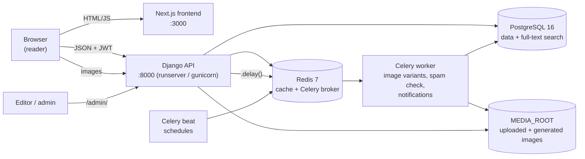
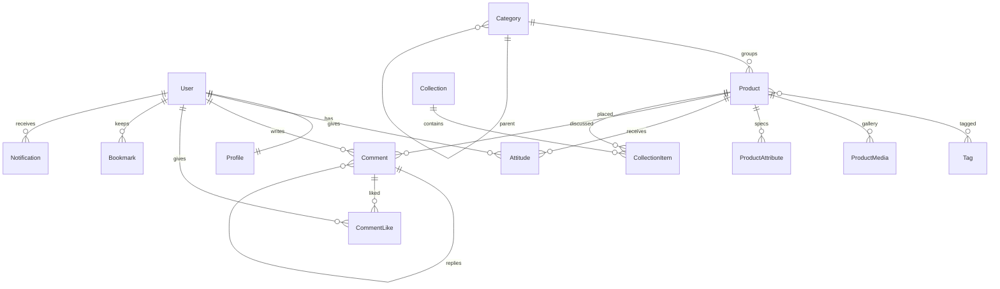

# Architecture

CurateShelf is a **modular monolith**: one Django project split into domain apps, plus a separate
Next.js frontend and two Celery processes. Each Django app owns its models, API endpoints, admin and
background tasks, so it can be read (and later extracted) like a service. They share one database and
one deployment.

## Processes

| Process | Command (dev) | Port | Role |
|---------|---------------|------|------|
| Django API + admin | `python manage.py runserver` | 8000 | REST API under `/api/`, Unfold admin under `/admin/`, serves `/media/` in DEBUG |
| Next.js | `npm run dev` | 3000 | The reader-facing magazine (client-rendered pages that call the API) |
| Celery worker | `celery -A config worker` | – | Runs async tasks (optional in dev: tasks run inline, see below) |
| Celery beat | `celery -A config beat` | – | Fires scheduled tasks (publishing, nightly stats, weekly digest) |
| PostgreSQL | – | 5432 | Primary store; `SearchVectorField` + GIN index for search |
| Redis | – | 6379 | Django cache (health check) and Celery broker/result backend |

> **Eager tasks in development.** With `DEBUG=True`, `CELERY_TASK_ALWAYS_EAGER` defaults to `True`, so
> every `.delay()` runs synchronously inside the web request. You only need the worker and beat
> processes to exercise real queueing or the schedules.

## The "services" (Django apps)

| App | Owns | Talks to | Doc |
|-----|------|----------|-----|
| `apps.users` | `User` (email login), `Profile` | engagement (public attitude lists) | [authentication.md](backend/authentication.md) |
| `apps.catalog` | `Product`, `Category`, `Tag`, `ProductMedia`, `ProductAttribute` | – (the core others point at) | [catalog.md](backend/catalog.md) |
| `apps.engagement` | `Attitude`, `Comment`, `CommentLike`, `Bookmark` | catalog (counters), users (profile counters), notifications | [engagement.md](backend/engagement.md) |
| `apps.editorial` | `Collection` (shelf), `CollectionItem` | catalog | [editorial.md](backend/editorial.md) |
| `apps.notifications` | `Notification` | engagement, catalog, users, email | [notifications.md](backend/notifications.md) |
| `apps.core` | `/api/health/` | DB, cache | [overview.md](backend/overview.md#health-check) |

Dependency direction: `catalog` sits at the bottom. `engagement`, `editorial` and `notifications`
depend on it, and nothing in `catalog` imports them. Cross-app imports inside functions
(`from apps.engagement.models import Attitude`) are used where a reverse dependency is unavoidable, to
avoid import cycles.

## Data model

Denormalised counters keep the feed fast:

- `Product.love_count / curious_count / skip_count` are updated atomically on every attitude change.
- `Profile.loves_given / curious_given / skips_given` are updated the same way.
- `Comment.likes_count` is updated on like and unlike.
- The nightly `recompute_attitude_stats` task rebuilds all of them from source rows (self-healing).

## A request, end to end

Example: a signed-in reader taps **Love** on a feed story.

1. `AttitudeBar` (frontend) updates the counts locally right away (optimistic UI).
2. It calls `PUT /api/products/<slug>/attitude/` with `{ "kind": "love" }` and
   `Authorization: Bearer <access>`.
3. `JWTAuthentication` resolves the user. `ProductAttitudeView` loads the published product.
4. `apply_attitude()` runs in a transaction with `SELECT … FOR UPDATE` on the existing attitude, swaps
   kinds if needed, and adjusts product and profile counters with `F()` expressions.
5. The response returns the authoritative counts. The UI reconciles them, or rolls back on error.

## Frontend ↔ backend contract

- All calls go through `frontend/src/lib/api.ts` (`request()` adds the JSON header and the bearer
  token from `localStorage`).
- Images are absolute URLs from Django (`/media/...`) and are rendered with `next/image`. The allowed
  hosts are configured in `frontend/next.config.ts`.
- CORS: `CORS_ALLOWED_ORIGINS` must include the frontend origin (`http://localhost:3000` by default).
